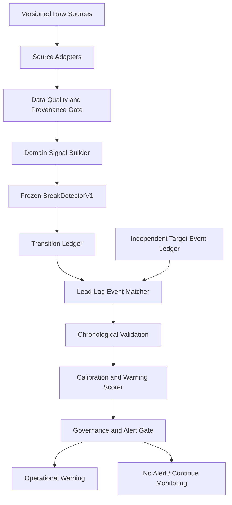

# خطة محرك الاستشعار التنبؤي للإنذار المبكر (Predictive Early-Warning Sensing Engine)

**الحالة:** تصميم معماري للمرحلة التالية؛ لا يوجد نموذج تنبؤي معتمد حتى الآن.  
**الأساس الثابت:** `BreakDetectorV1` المجمد في `structural_engine/isolated_break_detector_v1/`.

## 1. الهدف وحدود المسؤولية

المحرك التنبؤي لا يساوي كاشف التحولات:

- **كاشف التحولات** يحدد أن خصائص سلسلة زمنية تغيرت.
- **محرك الاستشعار** يحول التحولات إلى إشارات ذات توقيت واتجاه ومصدر موثق.
- **محرك الإنذار المبكر** يختبر هل تسبق هذه الإشارات أحداثاً مستهدفة محددة، وبأي مهلة وبأي معدل إنذارات كاذبة.

لا تُصدر إشارة `CONFIRMED` تنبؤاً تلقائياً. معناها الحالي تأكيد داخل قواعد الكاشف أو اتفاق بين كاشفين، وليس إثباتاً خارجياً أو علاقة سببية.

## 2. المعمارية المقترحة

### المكونات

1. **Source Adapters** — تحميل المصدر كما نُشر، تثبيت نافذة التغطية والتواتر والمنطقة والوحدات وبصمة SHA-256. لا يُعامل غياب الملف على أنه صفر.
2. **Data Quality Gate** — فحص الفجوات والتكرار والقيم المتساوية والتغير في تعريف المصدر وتدهور مقياس خط الأساس.
3. **Domain Signal Builder** — إنشاء تمثيل معلن خاص بالمجال. للزلازل يمكن الاحتفاظ بعدّ الأحداث، والفواصل بين الأحداث، ومقاييس الشدة، كل منها سلسلة مستقلة لا تُخلط تلقائياً.
4. **Frozen BreakDetectorV1** — تشغيل `fast` أو `markov_cusum` أو `consensus` دون تعديل رياضيات النسخة المجمدة.
5. **Transition Ledger** — سجل غير قابل للاستبدال يحتفظ بالمصدر والتمثيل والتوقيت والبداية المقدرة ووقت الكشف والتأكيد والاتجاه والحالة والبصمات وإصدار الكاشف.
6. **Target Event Ledger** — سجل مستقل للأحداث المطلوب الإنذار بها، مع تعريف الحدث ومصدره ووقت وقوعه وقواعد الإدراج والاستبعاد.
7. **Lead-Lag Event Matcher** — مطابقة سببية زمنياً فقط: يجب أن تكون إشارة الاستشعار أسبق من الحدث المستهدف. تُحفظ الحالات غير المحسومة والمراقبة المنتهية دون حدث بوصفها censored، لا كسلبيات مؤكدة.
8. **Chronological Validation** — تقييم زمني متتابع؛ لا تقسيم عشوائي للسجلات الزمنية ولا استخدام بيانات المستقبل في بناء الإشارة.
9. **Calibration and Warning Scorer** — حساب احتمال أو مستوى خطر ومهلة متوقعة فقط بعد إثبات علاقة مستقرة خارج العينة.
10. **Governance and Alert Gate** — يقرر هل تُرسل إشارة تشغيلية أم تبقى للمراقبة، وفق عبء الإنذارات الكاذبة وتكلفة الإخفاق وحدود الثقة وإمكانية إعادة التشغيل.

## 3. عقد الإشارة والسجل

كل سجل تحول يجب أن يحمل على الأقل:

- `source_id`, `source_sha256`, `source_contract_version`.
- `series_id`, `representation_id`, `frequency`, `transform`, `units`.
- `detector_version`, `mode`, `thresholds`, `sample_adequacy`.
- `estimated_onset`, `detection_time`, `confirmation_time`, `direction`.
- `status`: `PROVISIONAL`, `CONFIRMED`, `TRANSIENT`, أو `UNRESOLVED`.
- `confirmation_basis`: قاعدة Markov الداخلية أو اتفاق Fast/Markov، إن وجدت.
- `resolution_time`, `resolution_reason`, وبيانات PENDING المرتبطة.

تظل `PROVISIONAL` و`UNRESOLVED` داخل السجل. لا تتحولان إلى إنذار للمستخدم لمجرد ظهورهما.

## 4. تعريف التنبؤ والمهلة

لكل حدث مستهدف وقت وقوع (t_e)، ولكل إشارة مؤكدة وقت متاح للاستعمال (t_s):

[
L = t_e - t_s
]

لا تُعد الإشارة إنذاراً مبكراً صالحاً إلا إذا:

- (L > 0)، أي أن الإشارة سبقت الحدث فعلياً.
- وقع الحدث ضمن أفق الإنذار (H) الذي حُدد قبل الاختبار.
- لم تُستخدم بيانات لاحقة لوقت الإشارة في حسابها.
- تكرر الأداء في فترات اختبار زمنية مستقلة.

تُحسب على نحو منفصل: معدل الإنذار الكاذب، حساسية التقاط الأحداث، نسبة الأحداث الفائتة، توزيع المهلة، الإنذارات لكل وحدة زمن، والحالات المراقبة التي انتهت دون حدث.

## 5. بوابات الاعتماد

| البوابة | شرط العبور | المخرج |
|---|---|---|
| G0 — Data Readiness | مصدر خام متاح، تغطية موثقة، وحدات وتواتر واضحان، لا فجوات مخفية | سلسلة قابلة لإعادة البناء |
| G1 — Sensor Integrity | استقرار الإشارة عبر إعادة التشغيل والتمثيلات المعلنة، مع ضبط التدهور والإنذارات العابرة | سجل تحولات موثوق |
| G2 — Temporal Association | علاقة lead/lag متكررة على أحداث مستقلة وباتجاه زمني صحيح | فرضية استشعار قابلة للاختبار |
| G3 — Predictive Validation | تحسن خارج العينة على خطوط أساس، مع حساسية وعبء إنذار ومهلة قابلة للقياس | نموذج تنبؤ معاير |
| G4 — Operational Approval | حدود تشغيلية، مراقبة انحراف، سجل تدقيق، وخطة إيقاف/تراجع | إنذار تشغيلي محدود النطاق |

الفشل في أي بوابة يوقف الانتقال إلى التالية؛ لا تُخفّض المعايير لتبرير نتيجة.

## 6. ترتيب التنفيذ

### P2.1 — Historical Transition Ledger

**منجز مبدئياً:** تشغيل السلاسل الزلزالية الشهرية والفصلية وسلاسل الفواصل بين الأحداث، وتشغيل فحص UN AMA السنوي. النتائج والبصمات محفوظة في المستودع.

### P2.2 — Sensor Integrity and Independent Review

الخطوة التالية:

1. مراجعة أحداث خليج عدن التي رصدها Markov في 2010 و2023 مقابل سجل USGS الخام وتوزيع الفواصل قبلها وبعدها.
2. مراجعة حدث السلسلة العالمية في 2022، والتحقق من أن التحول ليس نتيجة تغير التغطية أو تركيب الكتالوج.
3. اختبار حساسية النتائج لتعريف الحدث والحد الأدنى للمقدار ونافذة المصدر، دون تعديل الكاشف.
4. إضافة اختبارات null مناسبة لعمليات الأحداث، بما فيها تغير كثافة التسجيل والتجمعات قصيرة الأجل.
5. إبقاء نتائج UN AMA الثلاثة `PROVISIONAL`؛ تاريخها السنوي لا يسمح باستكمال أفق التأكيد أو الحل.

### P2.3 — Target Event Association

اختيار حدث مستهدف مستقل وتعريفه قبل المطابقة، ثم اختبار ما إذا كانت إشارات الاستشعار تسبقه. لا تُستنتج علاقة تنبؤية من سلسلة واحدة لا تحتوي على تعريف مستقل للهدف.

### P2.4 — Predictive Scoring

لا يبدأ إلا إذا أثبتت P2.3 علاقة متكررة. يبدأ بخط أساس بسيط قابل للتفسير، ثم معايرة الاحتمالات ومقارنة الأداء زمنياً. لا حاجة لإضافة نموذج معقد قبل إثبات القيمة الإضافية.

### P2.5 — Governed Warning

تفعيل تنبيه محدود النطاق فقط بعد اجتياز G0–G4، مع مراقبة مستمرة للانحراف وتوثيق كل إنذار وقرار عدم الإنذار.

## 7. القرارات التي يجب عدم خلطها

- لا تُغيّر عتبة H=8.5 أو معادلات المحرك المجمد أثناء تقييم البيانات الحقيقية.
- لا تُعامل `CONFIRMED` كتحقق جيولوجي مستقل.
- لا تُعامل `TRANSIENT` أو `UNRESOLVED` كتحول مستقر.
- لا تُحوّل التقدم الزمني أو الارتباط إلى سببية.
- لا تُصدر توقعات زلزالية من مجرد تغير الفواصل بين الأحداث.
- لا تُستخدم السلاسل السنوية ذات 54 نقطة كما لو كانت قادرة على استكمال أفق 14 أو 35 خطوة.

**المخرج التالي المطلوب:** مراجعة مستقلة للأحداث الثلاثة المؤكدة داخلياً في سلاسل الفواصل بين الزلازل، ثم بناء اختبار lead/lag لهدف مستقل. لا يبدأ تدريب نموذج تنبؤي قبل ذلك.
