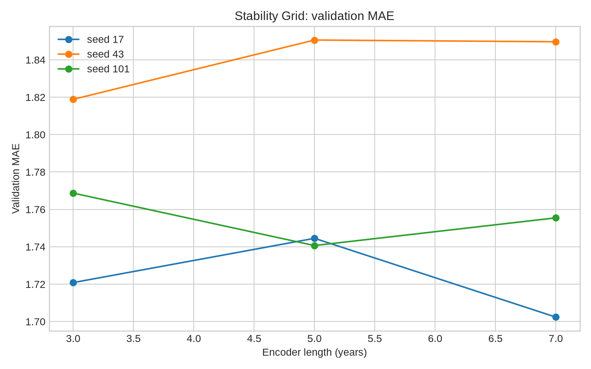
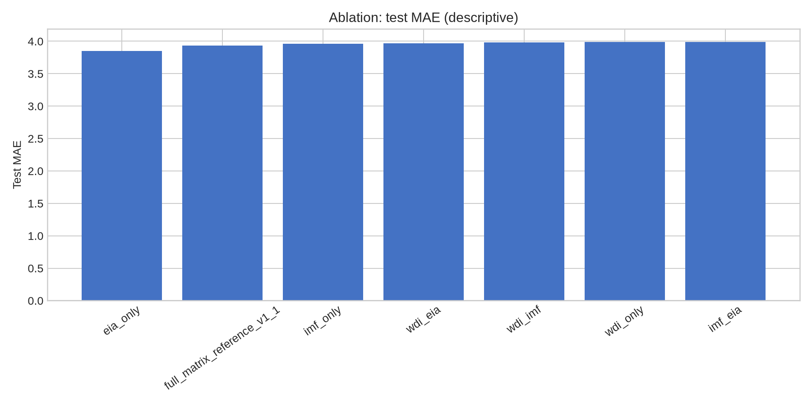
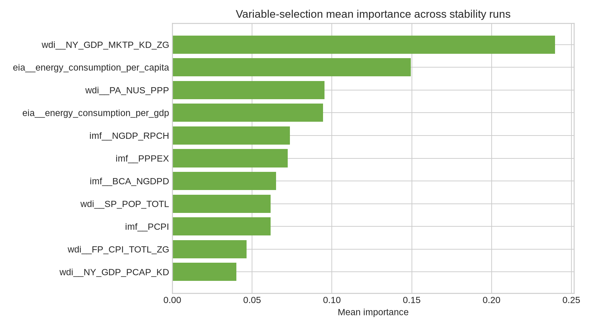
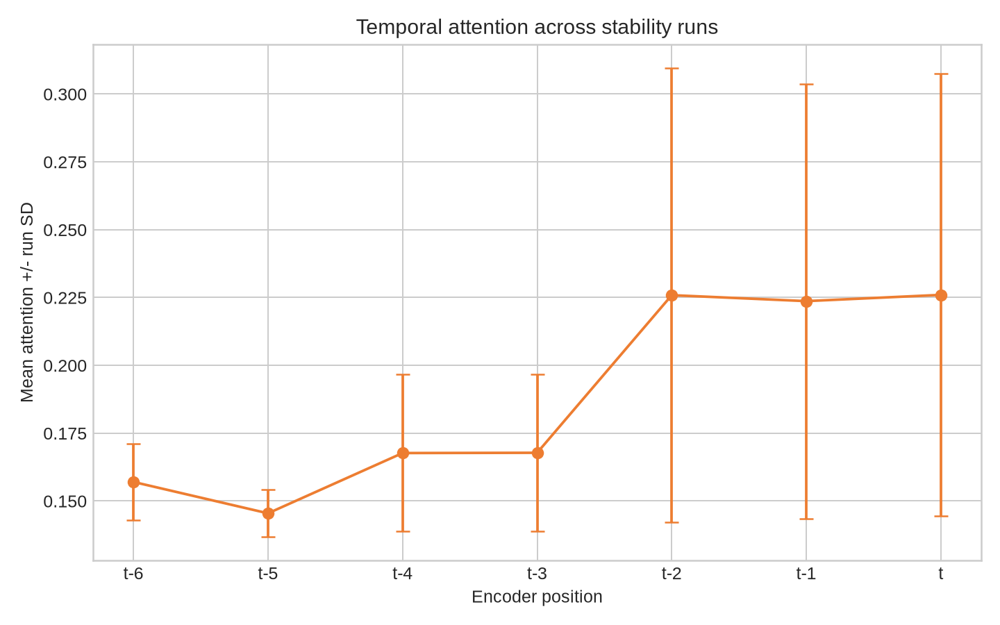

# تقرير المرحلة التجريبية التالية — Stability / Ablation / Importance

## الحالة التنفيذية

اكتملت 9 تشغيلات Stability، و6 تشغيلات Ablation جديدة مع مرجع Full Matrix، وتشغيلتا Target-History Ablation، ثم تحليل variable-selection وattention وencoder-step importance. لم تُشغّل Reverse Extraction أو surrogate validation، ولم تُجمع بيانات جديدة أو تُعدّل raw data. تم اختيار إعداد stability من validation فقط؛ test وصفي.

## 1. Stability Grid

أفضل تشغيل وفق validation MAE هو **stability_seed17_enc7**: seed=17، encoder=7، validation MAE=1.7024، validation RMSE=2.7055.

|   encoder |   val_MAE_mean |   val_MAE_sd |   test_MAE_mean |   test_MAE_sd |
|----------:|---------------:|-------------:|----------------:|--------------:|
|    3.0000 |         1.7695 |       0.0490 |          3.9504 |        0.0479 |
|    5.0000 |         1.7786 |       0.0624 |          3.9604 |        0.0562 |
|    7.0000 |         1.7692 |       0.0746 |          3.9672 |        0.0593 |

الفروق عبر encoder متقاربة، وأثر seed واضح؛ لذلك لا توجد configuration مستقرة بقوة حتى الآن.

## 2. Ablation Experiments

| arm                        |   val_MAE |   val_RMSE |   test_MAE |   test_RMSE |   test_R2 |   test_directional_accuracy |
|:---------------------------|----------:|-----------:|-----------:|------------:|----------:|----------------------------:|
| wdi_only                   |    1.5502 |     2.5856 |     3.9926 |      6.6809 |    0.0184 |                      0.7698 |
| wdi_eia                    |    1.5581 |     2.5815 |     3.9692 |      6.6796 |    0.0188 |                      0.7741 |
| wdi_imf                    |    1.5588 |     2.6078 |     3.9816 |      6.6714 |    0.0212 |                      0.7669 |
| imf_eia                    |    1.5619 |     2.6588 |     3.9927 |      6.6903 |    0.0157 |                      0.7741 |
| imf_only                   |    1.5910 |     2.6516 |     3.9595 |      6.6772 |    0.0195 |                      0.7741 |
| full_matrix_reference_v1_1 |    1.6014 |     2.5955 |     3.9360 |      6.6332 |    0.0324 |                      0.7741 |
| eia_only                   |    1.6038 |     2.6398 |     3.8471 |      6.5646 |    0.0523 |                      0.7755 |

في validation كان WDI-only الأفضل بين arms الجديدة MAE=1.5502. في test كان EIA-only أقل MAE=3.8471، لكن test لم يُستخدم للاختيار. التناقض بين validation وtest يمنع نسبة أثر ثابت لأي domain.

## 3. Target-History Ablation

| arm                        |   val_MAE |   val_RMSE |   test_MAE |   test_RMSE |   test_R2 |   test_directional_accuracy |
|:---------------------------|----------:|-----------:|-----------:|------------:|----------:|----------------------------:|
| target_history_only        |    1.5743 |     2.6181 |     4.0256 |      6.7142 |    0.0086 |                      0.7698 |
| exogenous_only             |    1.5928 |     2.6060 |     3.9400 |      6.6806 |    0.0185 |                      0.7755 |
| full_matrix_reference_v1_1 |    1.6014 |     2.5955 |     3.9360 |      6.6332 |    0.0324 |                      0.7741 |

target-history-only أضعف على test من exogenous-only وFull Matrix. الفارق الصغير بين exogenous-only وFull Matrix لا يكفي لإثبات مساهمة مستقلة مستقرة لتاريخ الهدف.

## 4. Variable / Temporal Analysis

| variable                           |   runs |   mean_importance |   std_across_runs |   top3_run_count |
|:-----------------------------------|-------:|------------------:|------------------:|-----------------:|
| wdi__NY_GDP_MKTP_KD_ZG             |      9 |            0.2397 |            0.1327 |                9 |
| eia__energy_consumption_per_capita |      9 |            0.1495 |            0.0730 |                9 |
| wdi__PA_NUS_PPP                    |      9 |            0.0954 |            0.0456 |                0 |
| eia__energy_consumption_per_gdp    |      9 |            0.0945 |            0.0958 |                9 |
| imf__NGDP_RPCH                     |      9 |            0.0738 |            0.0435 |                0 |
| imf__PPPEX                         |      9 |            0.0723 |            0.0396 |                0 |
| imf__BCA_NGDPD                     |      9 |            0.0650 |            0.0394 |                0 |
| wdi__SP_POP_TOTL                   |      9 |            0.0617 |            0.0302 |                0 |
| imf__PCPI                          |      9 |            0.0616 |            0.0349 |                0 |
| wdi__FP_CPI_TOTL_ZG                |      9 |            0.0465 |            0.0319 |                0 |
| wdi__NY_GDP_PCAP_KD                |      9 |            0.0401 |            0.0203 |                0 |

ظهر تاريخ الهدف ومتغيرا EIA ضمن أعلى ثلاثة في 9/9 تشغيلات وفق هذا المقياس الوصفي. هذا candidate descriptive pattern فقط؛ لا يثبت السببية.

### المواقع الزمنية

| encoder_position   |   runs |   mean_attention |   std_across_runs |   top_run_count |
|:-------------------|-------:|-----------------:|------------------:|----------------:|
| t-6                |      3 |           0.1570 |            0.0142 |               3 |
| t-5                |      3 |           0.1455 |            0.0088 |               0 |
| t-4                |      6 |           0.1677 |            0.0290 |               1 |
| t-3                |      6 |           0.1678 |            0.0289 |               0 |
| t-2                |      9 |           0.2259 |            0.0838 |               3 |
| t-1                |      9 |           0.2237 |            0.0801 |               0 |
| t                  |      9 |           0.2260 |            0.0814 |               2 |

لم يبلغ أي موقع زمني واحد 6/9 كـtop attention؛ لذلك لا يوجد lag مستقر مسجل.

## 5. Candidate patterns والنتائج السلبية

| المرشح | الحالة | الدليل الحالي | القيد |
|---|---|---|---|
| target history ضمن أعلى 3 variables | Candidate descriptive | 9/9 stability runs | ليس causal ويحتاج robustness |
| EIA energy per capita ضمن أعلى 3 | Candidate descriptive | 9/9 stability runs | لا يثبت أن الطاقة سبب |
| EIA energy per GDP ضمن أعلى 3 | Candidate descriptive | 9/9 stability runs | لا يثبت السببية أو التعميم |
| lag/temporal position | لا candidate مستقر | لا موقع بلغ 6/9 | الانتباه ليس اختبار lag سببي |

## 6. التناقضات والقيود

1. العقد v1.1 raw-value mode، ولم يُستخدم تطبيع أو imputation.
2. أفضل validation arm ليس أفضل test arm؛ لا يجوز اختيار EIA-only من test.
3. Stability استخدمت support start=2008 لمقارنة encoder 3/5/7، بينما baseline الأصلي يبدأ من 2006؛ لذلك ليست أرقامها متطابقة تماماً مع baseline الأول.
4. Target-history arms B وD متطابقان دلالياً؛ شُغّل exogenous-only مرة واحدة وسُجل التكرار.
5. Full Matrix هو مرجع baseline v1.1 أُنجز بـ max_epochs=50، بينما أذرع المرحلة الجديدة أُنجزت بـ max_epochs=25؛ لذلك المقارنة المرجعية ليست تطابقاً كاملاً في ميزانية التدريب.
6. لم تُنفذ quantile uncertainty أو event holdout أو Reverse Extraction أو surrogate gate.

## 7. القرار المرحلي

تُسجل النتائج كـexploratory candidate evidence. لا توجد configuration أو variable أو lag مؤهلة للترقية إلى validated structural pattern. لا يبدأ Reverse Extraction تلقائياً؛ يحتاج عقداً مستقلاً ومراجعة لاحقة.

## 8. السجل والتحقق

السجل المضغوط لجميع التشغيلات والمرجع محفوظ في `NEXT_PHASE_EXPERIMENT_REGISTRY.jsonl`، بينما التفاصيل الكاملة للحملة في `CAMPAIGN_RUN_RESULTS.json`. أُنجز QA manifest في `NEXT_PHASE_QA_MANIFEST.json`، ويتضمن counts وhashes للرسوم والـcheckpoints والتحقق من ثبات ملفات raw مقارنةً بـHEAD. سجلات فشل وإصلاح مولد التقرير محفوظة في `logs/`، ولا تُحذف failures من provenance.

الملفات الداعمة الأساسية هي `STABILITY_RESULTS_TABLE.csv`، `STABILITY_BY_ENCODER.csv`، `STABILITY_BY_SEED.csv`، `ABLATION_RESULTS_TABLE.csv`، `TARGET_HISTORY_RESULTS_TABLE.csv`، وملفات `importance/`، إضافة إلى الرسوم الأربعة في `figures/`.

## 9. نقطة التوقف

هذه المرحلة مكتملة من ناحية التشغيل والتوثيق، لكنها لا تمنح اعتماداً بنيوياً أو سببياً لأي متغير أو lag. لم يبدأ Reverse Extraction، ولن يبدأ تلقائياً؛ التوقف هنا بانتظار مراجعة المستخدم وعقد مستقل للمرحلة التالية.
